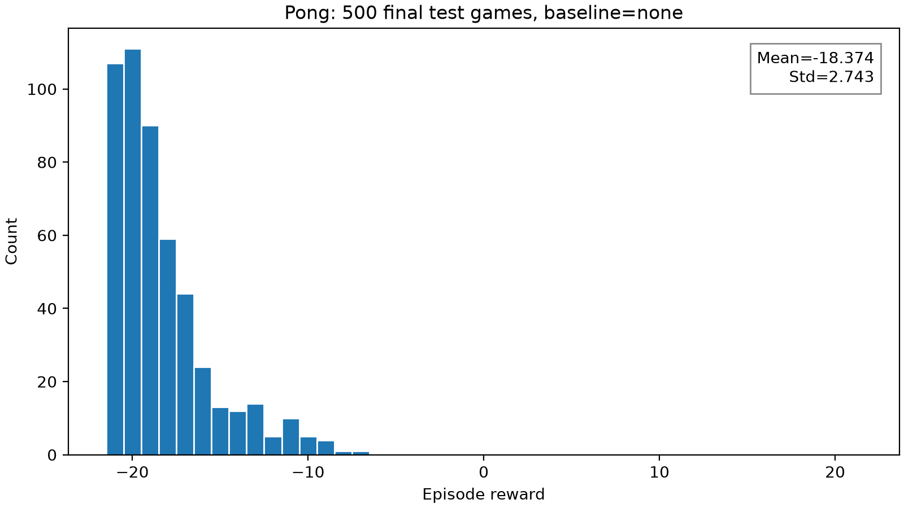
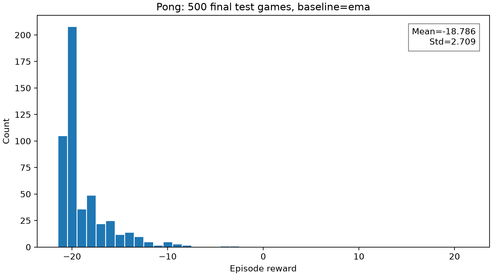
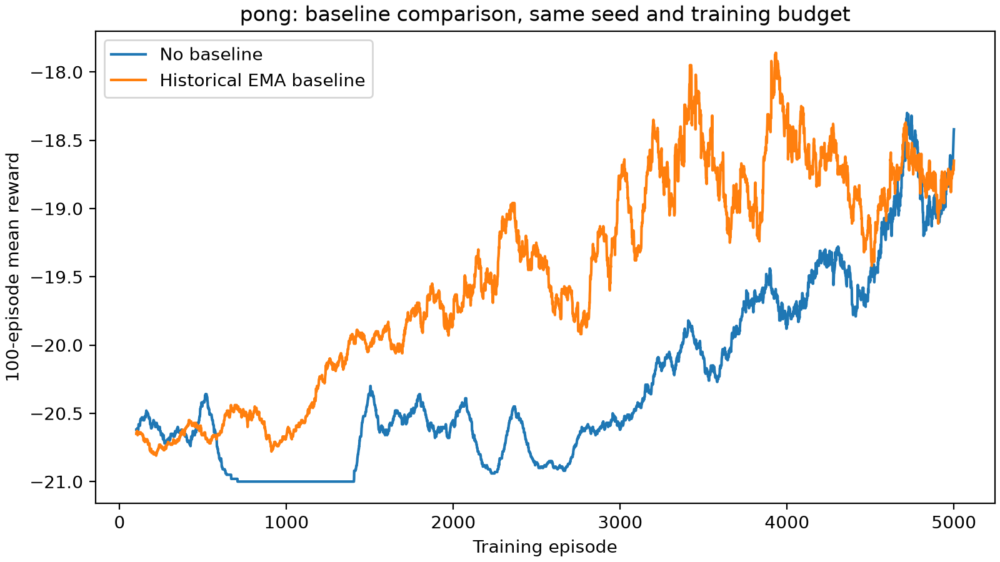
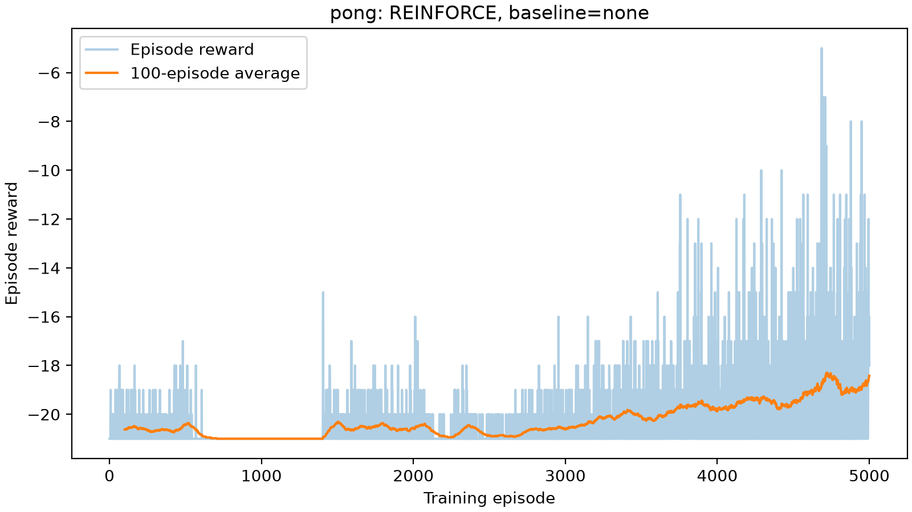
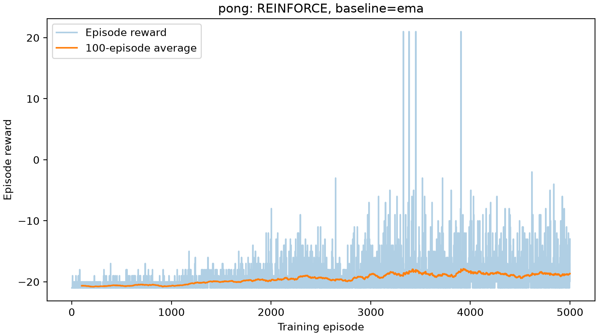

# Policy-gradient experimental results

Generated from recorded scores. Missing experiments remain PENDING.

| Game | Baseline | Training episodes | Test episodes | Mean | Std | Device |
|---|---|---:|---:|---:|---:|---|
| cartpole | none | 2000 | 500 | 123.094 | 36.230 | cpu |
| cartpole | ema | 2000 | 500 | 369.722 | 65.631 | cpu |
| pong | none | 5000 | 500 | -18.374 | 2.743 | cuda |
| pong | ema | 5000 | 500 | -18.786 | 2.709 | cuda |

## Interpretation

The EMA baseline uses only preceding episodes and is updated after the actor step.
Each reported model is frozen and evaluated for 500 stochastic-policy episodes.
These runs use one seed; they do not establish variability across random seeds.
A smaller policy-gradient variance does not imply a smaller standard deviation of episode scores.
CPU results are local experiments and do not certify completion of the Lab's Deepdish/GPU setup.

## Pong: final 500-game tests

Both selected models trained for 5000 episodes from the same initial weights: 128 hidden units, He hidden initialization and small output initialization, Adam lr=0.001, gamma=0.99, batch=1. The outer time discount was retained. Only the historical EMA baseline differs.
Each model was frozen and tested on seeds1000000–1000499, separate from tuning seeds200000–200049. Actions were sampled from the policy, with no parameter or baseline updates. Standard deviations use ddof=0.
EMA minus no-baseline mean score: -0.412. These are final evaluation results for one training seed; they do not establish general superiority across training seeds.

### 中文结果分析

无baseline：均值-18.374，标准差2.743，获胜0/500局。EMA baseline：均值-18.786，标准差2.709，获胜0/500局。
EMA减去无baseline的均分差为-0.412，按相同测试种子配对的bootstrap95%区间为[-0.706, -0.130]。区间不包含0，在本次测试种子上两个固定模型的平均得分有明确差异。
这次是独立于调参的正式500局测试，不能与之前50局验证混用。区间反映固定模型的测试局波动，不包含重新训练时的随机性；单训练种子无法证明某种算法普遍更好。奖励标准差也不是策略梯度方差。
训练过程中EMA组在中期改善更早，但后期两组得分逐渐接近。最终模型均仍以输球为主；保留完整结果，不根据正式测试继续选择超参数。

## Paired gradient-variance experiment

Baseline estimated from 20 separate pilot episodes; paired gradients use 40 further episodes under a fixed policy.
Sum of component variances: {'none': 891.859130859375, 'historical_ema': 151.81439208984375}.
EMA/no-baseline variance ratio: 0.170222.
