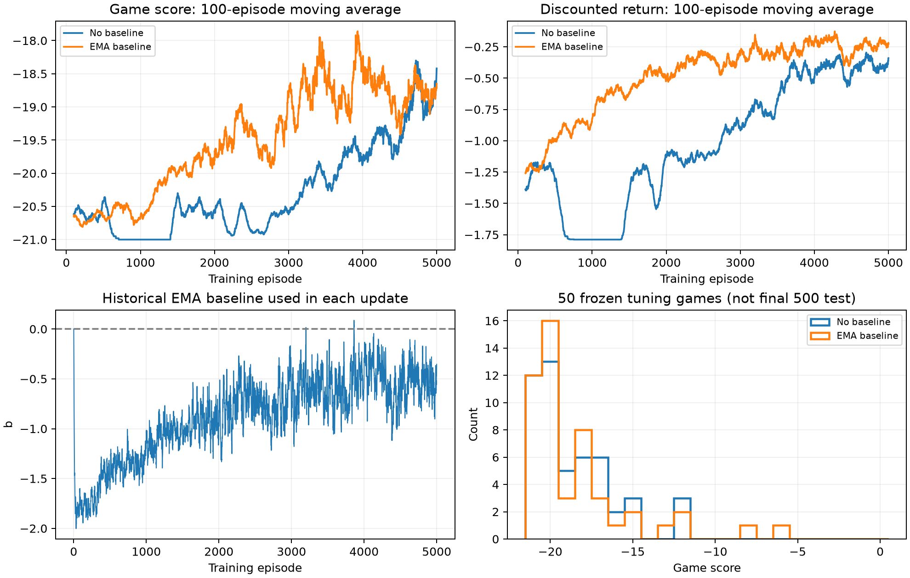
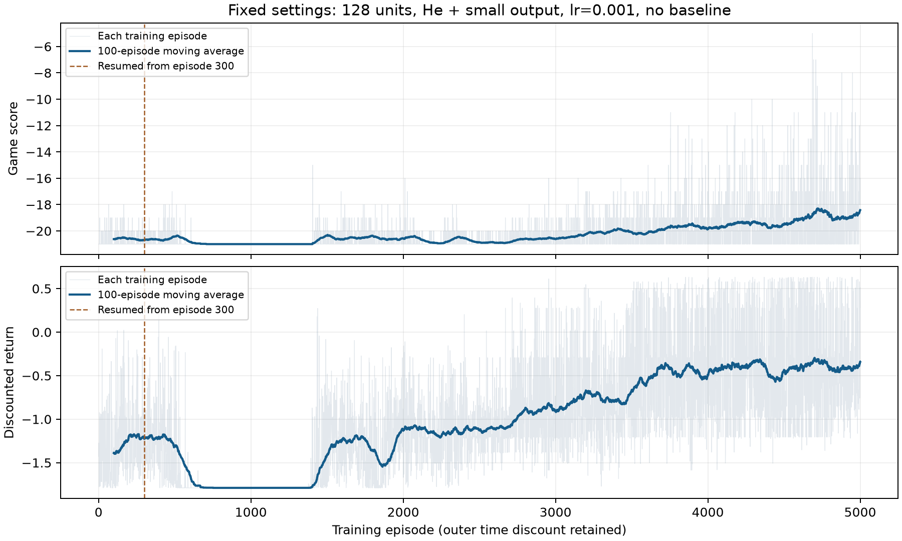
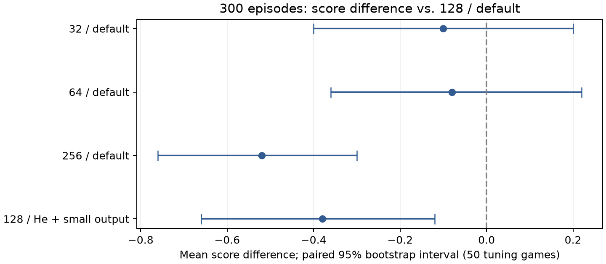

# Pong 分阶段优化记录

## 最新：正式500局测试已完成

无baseline：均值-18.374，标准差2.743；EMA：均值-18.786，标准差2.709。
EMA减去无baseline的得分差-0.412，配对95%区间[-0.706, -0.13]。
两组各500局，使用1000000–1000499独立测试种子；模型冻结。完整直方图、统计和中文分析见[正式实验报告](../report_results.md)。
下文保留各阶段当时的判断；其中“正式测试尚未运行”等表述为历史状态，本段为最新状态。


## 最新：baseline的5000局对照完成

相同50局冻结调参验证：无baseline均分-18.60，EMA均分-18.42，差+0.18，配对95%区间[-0.76,1.20]。得分标准差分别2.43、3.26，两组均0胜；折扣回报分别-0.335、-0.235，差+0.100，区间[-0.014,0.219]。

EMA在中期更早改善：2001–2500局均分-19.36对-20.72，3001–3500局-18.72对-20.16；4501–5000局已接近，为-18.78对-18.82。最终验证两项差值区间都跨0，不能确认5000局终点的稳定优势。EMA前256步动作熵0.094低于0.223，概率>99%的比例73.43%高于40.53%，探索更少。更新幅度更小不能单独证明梯度方差降低；结果也不能证明baseline普遍无效。

按用户预算完成两组各5000局；保存模型、Adam状态、日志、曲线与分析，结束本轮GPU任务和复查，不自动追加训练或更改设置。

固定预算对照已完成。中期改善没有转化为明确的终点得分优势；本次只有一个训练种子，50局也反复用于调参。等待用户讨论后续，正式独立500局测试仍未运行。

[详细统计与对照方法](baseline_5000_comparison.md)




## 无baseline：固定设置5000局训练完成

128隐藏单元、He隐藏层与小输出层初始化、学习率0.001、无baseline；保留内外层折扣。从300局模型及Adam状态继续4700局，中途没有改参数。

同一配置300→5000局：50局验证均分-20.70→-18.60，提高2.10，配对95%区间[1.46,2.78]；折扣回报-1.123→-0.335。最近100局训练均分-18.42。

后期训练和冻结验证均显示改善，300局不足以反映本配置的长期表现，但50局验证胜局为0，仍未学会稳定获胜。验证前256步动作熵0.650→0.223，概率>99%的比例0%→40.53%，探索明显收缩。单训练种子、反复使用调参种子限制推断，不能证明该初始化或128宽度优于其他配置；其他配置尚未完成同等5000局预算。

按用户指定完成累计5000局（从300局模型和Adam状态新增4700局），全部设置不变。进程已正常退出，保存模型、日志与报告；停止本轮复查，不自动追加训练或测试。

固定预算已完成，已观察到较晚出现的改善但表现仍较弱。下一步由用户讨论决定；50局是调参验证，正式独立500局测试尚未运行。

| 训练区间 | 整局得分均值 | 折扣回报均值 |
|---|---:|---:|
| 1–300 | -20.63 | -1.269 |
| 701–1400 | -21.00 | -1.788 |
| 1401–2000 | -20.52 | -1.303 |
| 2001–3000 | -20.71 | -1.056 |
| 3001–4000 | -19.99 | -0.609 |
| 4001–4500 | -19.51 | -0.414 |
| 4501–5000 | -18.82 | -0.387 |
| 4901–5000 | -18.42 | -0.340 |




## 历史300局网络对照结论

本次300局、单训练种子筛选中，32和64未显示整局得分优于128默认；256和128新初始化的整局得分更差。保留128默认作为参照，不宣称它在更长训练或其他种子下最优。

| 隐藏单元 | 初始化 | 300局后的游戏得分 | 折扣回报 |
|---:|---|---:|---:|
| 32 | default | -20.42 | -1.211 |
| 64 | default | -20.40 | -1.322 |
| 128 | default | -20.32 | -1.182 |
| 256 | default | -20.84 | -1.179 |
| 128 | he_small_output | -20.70 | -1.123 |

不追加训练；本轮无显示得分优势的新候选，暂不消耗额外新种子验证。GPU任务已自然结束，关闭自动复查，等待讨论下一步。
以上均为同50局调参验证，128默认使用历史300局控制；最终500局测试尚未完成。
区间只反映验证局波动，尚未检验不同训练种子的稳定性。




当前网络宽度与初始化对照恢复原公式 `-sum(gamma**t * (G_t-b) * log pi)`，学习率0.001，G内部gamma=0.99。历史no_outer_lr001曾去掉外层权重；其900局续训在640局停止，未完成的640局不能当作900局结果。
去掉外层权重改变了梯度估计；新损失不再标注为原始整局折扣目标的严格等价梯度。整局得分和折扣回报仍同时作为对照指标。
首轮100局用于粗筛，之后通常每300局检查；首次将100局补到累计300局。
续训依据是多个阶段的得分、折扣目标、探索情况和更新幅度，不再执行100局未提高1分就淘汰的硬规则。
从零训练使用相同训练种子；相同结构及初始化方案使用相同初始模型，宽度实验只保持初始化方法和种子一致，各结构单独建立未训练基准。学习率分支继承指定模型和Adam状态。首轮验证20局，后续50局；阶段比较只使用共有的验证种子。
验证用于调参，最终500局测试种子保持独立。单训练种子和反复验证均限制结论，不能据此宣称长期最优。

## 阶段结果

| 配置 | 隐藏单元 | 初始化 | Baseline | 外层折扣 | 累计训练局数 | 本次新增 | 验证局数 | 游戏得分 | 折扣回报 | 动作熵 | 动作概率>99%的比例 |
|---|---:|---|---|---|---:|---:|---:|---:|---:|---:|---:|
| batch10_lr001 | 128 | default | none | 保留 | 100 | 100 | 20 | -20.25 | -1.430 | 0.689 | 0.0% |
| batch10_lr001 | 128 | default | none | 保留 | 300 | 200 | 50 | -20.40 | -1.351 | 0.680 | 0.0% |
| ema_lr001 | 128 | default | ema | 保留 | 100 | 100 | 20 | -20.95 | -1.214 | 0.638 | 0.0% |
| lr0003_from300 | 128 | default | none | 保留 | 600 | 300 | 50 | -20.32 | -1.144 | 0.658 | 0.0% |
| lr0003_from300 | 128 | default | none | 保留 | 900 | 300 | 50 | -20.56 | -1.209 | 0.651 | 0.0% |
| lr_0001 | 128 | default | none | 保留 | 100 | 100 | 20 | -20.55 | -1.446 | 0.692 | 0.0% |
| lr_001 | 128 | default | none | 保留 | 100 | 100 | 20 | -20.45 | -1.354 | 0.667 | 0.0% |
| lr_001 | 128 | default | none | 保留 | 300 | 200 | 50 | -20.32 | -1.182 | 0.664 | 0.0% |
| lr_001 | 128 | default | none | 保留 | 600 | 300 | 50 | -20.68 | -1.556 | 0.650 | 0.0% |
| lr_01 | 128 | default | none | 保留 | 100 | 100 | 20 | -20.90 | -1.142 | 0.104 | 72.2% |
| no_outer_lr001 | 128 | default | none | 去掉 | 300 | 300 | 50 | -20.36 | -1.305 | 0.671 | 0.0% |
| no_outer_lr001 | 128 | default | none | 去掉 | 600 | 300 | 50 | -19.80 | -1.167 | 0.566 | 0.2% |
| width128_he_small | 128 | he_small_output | none | 保留 | 300 | 300 | 50 | -20.70 | -1.123 | 0.650 | 0.0% |
| width128_he_small | 128 | he_small_output | none | 保留 | 5000 | 4700 | 50 | -18.60 | -0.335 | 0.223 | 40.5% |
| width128_he_small_ema | 128 | he_small_output | ema | 保留 | 5000 | 5000 | 50 | -18.42 | -0.235 | 0.094 | 73.4% |
| width256_default | 256 | default | none | 保留 | 300 | 300 | 50 | -20.84 | -1.179 | 0.640 | 0.0% |
| width32_default | 32 | default | none | 保留 | 300 | 300 | 50 | -20.42 | -1.211 | 0.660 | 0.0% |
| width64_default | 64 | default | none | 保留 | 300 | 300 | 50 | -20.40 | -1.322 | 0.664 | 0.0% |

lr0003_from300 继承 lr_001 的 300 局模型与Adam状态；学习率从 0.001 改为 0.0003。累计局数包含继承部分，并非全部使用新学习率。

## 结果、分析与调整理由

### 采用300局阶段检查

记录时间（UTC）：2026-10-24T17:39:35.420332+00:00
**结果**：前五组100局实验没有明确得分提升；0.01组动作过早固定。
**分析**：100局硬停止可能淘汰学习慢的配置。需要比较多个阶段，并同时观察折扣回报和游戏得分。
**决定**：lr_001和batch10_lr001从100补到累计300局，验证扩大到相同50局，再判断后续训练量。
**调整理由**：两组均保持探索。先只增加训练预算，避免同时改变学习率、网络和更新方式造成解释困难。

### lr_001：累计300局

记录时间（UTC）：2026-10-24T17:47:21.466143+00:00
**结果**：50局验证得分-20.32，相对初始模型+0.06，区间[-0.28,+0.38]；折扣目标增益+0.292，区间[+0.158,+0.431]；动作熵0.664，无概率饱和。
**分析**：游戏得分改善尚不明确，但实际优化目标有改善证据，且探索仍在；不能按原100局规则淘汰。
**决定**：保持学习率0.001、每局更新，续至累计600局，再检查。先完成batch10配置的300局对照。
**调整理由**：只延长训练，检验折扣目标改善是否持续、是否逐渐转化为总分提升。

### batch10_lr001：累计300局

记录时间（UTC）：2026-10-24T17:56:43.420656+00:00
**结果**：50局验证均分-20.40；折扣回报-1.351，相对初始增益+0.123，区间[-0.014,+0.253]；动作熵0.680，未饱和。
**分析**：相比单局0.001配置，同训练局数下目标改善更弱；300局只有30次参数更新，仍不能断言长期无效。
**决定**：保留300局断点，暂缓继续该配置；优先完成lr_001的600局检查。
**调整理由**：将下一阶段训练预算用于已有目标改善证据的配置；后续若调整batch配置，可只改变学习率进行同预算对照。

### 300局结果的回报时序诊断

记录时间（UTC）：2026-10-24T18:10:20.835786+00:00
**结果**：相同50局中，前300步净得分从-5.80提高到-5.02，整场从-20.38到-20.32；首个得分事件平均从70.26步到73.28步，赢得小分从0.62到0.68。
**分析**：折扣目标提升伴随开局阶段丢分减少，但整场赢分没有明显增加。与目标对早期奖励权重较高相一致，不能据此断言后半场完全没有学习。
**决定**：600局检查继续同时记录开局和整场指标，保留原折扣公式。
**调整理由**：避免将优化目标改善误报为游戏已学会，也避免仅凭总分平坦误判更新无效。

### lr_001：累计600局，退步后降低学习率

记录时间（UTC）：2026-10-24T18:12:48.619403+00:00
**结果**：50局验证得分-20.68，较300局下降0.36，配对区间[-0.64,-0.06]；折扣回报-1.556，较300局下降0.374，区间[-0.520,-0.223]；动作熵0.650，无概率饱和。
**分析**：这次不只是得分暂未提高：相同验证种子下，两个指标都比300局退步。探索尚未坍缩，可能存在单局梯度噪声与较大步长导致的策略漂移；当前数据不能单独确定原因。
**决定**：停止0.001原分支，保留300/600局模型；从300局模型与原Adam状态创建新分支，学习率改为0.0003，先新增300局到累计600局。
**调整理由**：从同一300局模型出发，只降低学习率，继续使用相同后续训练和验证种子；可以与原0.001的300→600阶段直接比较，避免同时改算法或网络。

### 降低学习率的600局对照

记录时间（UTC）：2026-10-24T18:21:42.619838+00:00
**结果**：同一300局起点继续：学习率0.0003的50局验证得分-20.32、折扣回报-1.144；原0.001为-20.68、-1.556。两者折扣差+0.412，区间[0.25883721858263015, 0.5596813014745713]；得分差+0.36，区间[0.08, 0.64]。较分支起点300局，折扣变化+0.038，区间[-0.086,+0.156]，没有明确进一步提高。
**分析**：减小步长在这次对照中保住了已有目标改善，支持更新幅度影响稳定性的解释；还不能排除训练种子影响。整局得分没有明确超过未训练模型，不能宣布学会Pong。
**决定**：保留两条600局分支；先用新种子300000–300049验证未训练模型、原300局、原600局及降低学习率后的600局模型，再决定下一训练阶段。
**调整理由**：300局模型曾根据旧验证集选中，需要新局面检验改善是否可重复；复核不更新模型、不消耗正式500局测试种子。

### 新50局复核完成，继续小学习率至900局

记录时间（UTC）：2026-10-24T18:27:28.633847+00:00
**结果**：新种子300000–300049：未训练得分-20.46、折扣回报-1.409；原300局模型-20.44、-1.193；原0.001训练至600局为-20.46、-1.473；降至0.0003后600局为-20.34、-1.239。较小学习率对原600局模型的折扣优势+0.234，区间[0.08486249158903957, 0.38789354483038185]。相对未训练的得分增益+0.12，区间[-0.16,+0.40]，尚不明确。
**分析**：换新局面后，原学习率继续训练造成的目标退步，以及小学习率保留早期改善的现象仍可见。但小学习率600局相对原300局，折扣变化-0.046，区间[-0.153,+0.061]，没有明确进一步改善；不能宣称小学习率已学会游戏或找到最优超参数。这组新种子已用于本次选择，今后不能再称为未见过的确认集。
**决定**：保持学习率0.0003、每局更新和无baseline，从已保存的600局模型继续新增300局，到900局检查；原公式、网络、奖励和动作集合不变。
**调整理由**：小学习率目前能保持探索，并避免原配置的明显目标退步，值得给一个额外阶段检验较慢的学习。若多个阶段仍只保持开局优势、整局得分没有改善，则优先研究梯度噪声（批次或作业要求的baseline），而非无限延长同一配置。

### 用户指定的新对照：去掉外层折扣，学习率0.001

记录时间（UTC）：2026-10-24T18:34:48.705372+00:00
**结果**：用户明确要求去掉之前讨论的额外权重。实现增加 --omit-time-discount；两种模式的600步解析梯度检查均通过，G内部折扣保持不变；真实短运行确认可恢复同模式、拒绝混用模式。尚无新Pong训练结果。
**分析**：新损失为-sum((G_t-b)*log pi)，本次b=0，gamma=0.99仍用于G_t内部。它不再被标注为原始整局折扣J的严格等价梯度；得分和折扣回报继续作为共同验证指标。去掉外层权重后，后半局动作不会再仅因时间较晚而被额外衰减。
**决定**：新建no_outer_lr001，从seed=0重新初始化；学习率0.001，每局更新、无baseline、先300局，再用相同50个调参种子验证。旧0.0003分支完成当前900局检查后不再优先续训。
**调整理由**：以旧lr_001的300局作为主要对照：学习率、初始化、训练种子、网络、动作和G计算一致，只有外层权重不同；避免同时从旧模型续训、改学习率造成混杂。

### 旧外层折扣分支完成900局，停止续训

记录时间（UTC）：2026-10-24T18:36:16.426668+00:00
**结果**：固定50局验证得分-20.56、折扣回报-1.209；较600局分别变化-0.24（区间[-0.56,+0.08]）、-0.065（区间[-0.167,+0.031]）。动作熵0.651，没有饱和。
**分析**：小学习率仍保留相对未训练模型的折扣回报优势，但从300至600再至900，整局得分没有明确提升，额外阶段也未显示持续改善。
**决定**：归档900局模型与验证；结束这条旧公式分支的续训，将单GPU用于用户要求的no_outer_lr001对照。
**调整理由**：当前证据不足以支持继续加长同一旧配置；用户已明确更改实验方向。新实验主要与相同学习率0.001的旧300局配置比较，避免把不同学习率的差异归因于损失。

### 去掉外层折扣：300局完成，继续到600局

记录时间（UTC）：2026-10-24T18:46:36.638518+00:00
**结果**：固定50局：新版本得分-20.36，折扣回报-1.305；旧版同学习率、同300局为-20.32、-1.182。新减旧得分差-0.04，区间[-0.36, 0.28]；折扣回报差-0.123，区间[-0.2764186651855707, 0.02165322982519859]。新版本每100局训练均分依次-20.64、-20.38、-20.25，最后50局-19.98。验证动作熵0.671，无概率饱和。
**分析**：本阶段没有证据显示去掉外层折扣已经改善整局表现；相对未训练模型的验证得分差也只有+0.02，区间[-0.30,+0.34]。不过训练后段出现较好的描述性趋势，探索正常；训练窗口变化不能代替冻结验证。前100局梯度幅度约为旧版4.75倍，实际参数更新量仍接近，没有数值爆炸迹象。
**决定**：保持去掉外层折扣、G内gamma=0.99、学习率0.001、每局更新和无baseline，直接从300局检查点新增300局至600局。
**调整理由**：先检验这个新版本的后段趋势能否持续并转化为验证改善，避免在首次300局便同时改更多因素。如果后续多个阶段仍停滞，则对单局梯度噪声做针对性对照；不将此次结果报告成新公式优于旧公式。

### 去掉外层折扣：600局验证改善，先用新种子复核

记录时间（UTC）：2026-10-24T18:56:50.748186+00:00
**结果**：固定50局验证均分-19.80，较300局-20.36提高0.56，配对bootstrap 95%区间[+0.24,+0.86]；折扣回报从-1.305改善至-1.167，增益+0.138，区间[+0.006,+0.274]。同预算旧版600局得分-20.68、折扣回报-1.556。验证动作熵0.566，动作概率超过99%的比例0.25%。
**分析**：这是新版本从300到600局的整局验证改善，两个指标方向一致；目前仍然明显落后于对手，尚未学会Pong。探索减少但没有概率全面饱和，更新保持有限；没有证据要求立刻改学习率。固定50种子已多次参与选择，需要新局面复核。
**决定**：保持600局模型冻结，使用新种子400000–400049，顺序评价未训练模型、新版本300局和600局模型；完成后再决定下一训练阶段。
**调整理由**：先检验得分进步能否在未参与调参的局面重现；不按单阶段未提高1分的旧标签淘汰，也不为了看到改善而同时改多个因素。此复核属于调参，不能代替最终500局测试。

### 600局新种子复核完成，保持设置续训至900局

记录时间（UTC）：2026-10-24T19:01:48.582928+00:00
**结果**：新50局（400000–400049）：未训练均分-20.48；300局模型-20.26，折扣回报-1.208；600局模型-19.98，折扣回报-1.256。600相对300的得分增益+0.28，配对95%区间[-0.08,+0.64]；折扣变化-0.047，区间[-0.225,+0.118]。600相对未训练得分提高0.50，区间[+0.14,+0.84]；探索熵0.561，概率饱和比例0.23%。
**分析**：新局面的整局得分方向与固定验证一致，但300→600的增益区间跨0，证据比固定验证弱；折扣回报的进一步提高未在新种子重现。因此只能说出现了早期改善迹象，不能声称持续稳定改善或已学会。每100局训练得分从-20.64逐步到-20.03，更新未失控；最近300次更新的参数相对变化均值约1.22%、最大1.91%，没有数值爆炸。
**决定**：不改超参数：保持学习率0.001、去掉外层gamma**t、G内部gamma=0.99、每局更新、无baseline、原网络和动作2/3；从600局模型和原Adam状态再训练300局，到900局验证。只启动这一阶段。
**调整理由**：两个验证集的整局得分方向及训练趋势支持再观察一个阶段；当前没有充分证据改学习率。900局需比较300/600/900整体走势与探索变化；若得分停滞或回退且动作趋于饱和，再针对更新幅度或梯度噪声做单因素对照，不盲目延长。此新种子组现已参与选择，下一次全新复核从400050开始；正式500局测试仍未运行。

### 用户要求恢复外层折扣，进行隐藏宽度与初始化对照

记录时间（UTC）：2026-10-24T19:08:33.482974+00:00
**结果**：用户将方向改为原公式、学习率0.001，比较隐藏单元及初始化。no_outer_lr001的900局续训已在640局保存后停止；完整600局训练和新种子复核仍保留。尚无新网络300局结果。默认128模型与旧实现逐参数一致，原公式解析梯度、各宽度梯度及模型恢复检查通过。 Deepdish真实Pong短测完成3次更新，256默认与128新初始化均运行正常，同设置续训保留Adam步数，更换宽度或初始化时拒绝沿用同名检查点。正式四组串行队列已启动。
**分析**：比较32/64/128/256时固定默认初始化方法；128默认已有完全匹配的300局控制模型。另用128单元只改变初始化方案（隐藏层He正态、偏置0、输出层小正交权重），可分开观察宽度和初始化影响。每个结构建立自己的未训练验证基准，不能共用128初始策略来夸大学习提升。
**决定**：复用lr_001的原始300局结果；新增width32_default、width64_default、width256_default、width128_he_small，各自从seed=0训练300局并验证50局；单GPU串行运行，预算总计1200局，不自动为某组追加训练。
**调整理由**：四组新训练分别隔离一个因素。保持公式、lr、动作、预处理、奖励、训练和验证种子一致；完成全部初筛后再比较候选，入选者另用未参与选择的新验证种子复核。单训练种子不足以证明通用优劣。

### 网络对照：width32_default完成300局

记录时间（UTC）：2026-10-24T19:20:02.064730+00:00
**结果**：50局得分-20.42，折扣回报-1.211；相对128默认得分差-0.10，配对95%区间[-0.40,+0.20]；动作熵0.660，概率饱和比例0.00%。
**分析**：32单元相对128默认：得分变化-0.10（95%区间[-0.40,+0.20]），折扣回报变化-0.029（区间[-0.177,+0.113]），两者都没有明确差异。相对32单元自身未训练得分-20.62，训练后提升0.20，但区间[-0.08,+0.48]仍跨0；不能宣称缩小网络已经改善学习。动作熵0.660、概率饱和比例0%，探索未坍缩；300局模型指纹与验证记录一致。
**决定**：32单元组按计划停在300局，保留模型和Adam状态；64单元组已由同一队列自动开始，随后仍按计划测试256单元和128新初始化。
**调整理由**：当前证据不能支持把128改成32，也不足以淘汰32的长期潜力；本轮目的为同预算初筛，先完成剩余预定对照，不追加训练或同时改其他因素。

### 网络对照：width64_default完成300局

记录时间（UTC）：2026-10-24T19:28:54.324082+00:00
**结果**：50局得分-20.40，折扣回报-1.322；相对128默认得分差-0.08，配对95%区间[-0.36,+0.22]；动作熵0.664，概率饱和比例0.00%。
**分析**：64单元验证得分-20.40，相对128默认-20.32的差为-0.08（配对95%区间[-0.36,+0.22]），没有明确游戏得分优势；折扣回报-1.322较128的-1.182更差，差-0.140，区间[-0.272,-0.013]。相对64单元自身未训练得分-20.70，得分改善0.30（区间[+0.080,+0.54]），折扣回报改善0.232，说明有学习迹象，但初始基准不同，不能据此宣称64优于128。动作熵0.664、饱和比例0%，探索尚正常；验证绑定的300局模型指纹已核对。
**决定**：64单元组按计划停止于300局，保留检查点与Adam状态；队列继续256默认组，再测试128新初始化，不在当前阶段改参数或追加训练。
**调整理由**：先完成统一预算下所有预定对照；32和64目前均未显示整局得分优于128。单种子结果且验证集重复用于调参，最终候选仍需新种子复核。

### 网络对照：width256_default完成300局

记录时间（UTC）：2026-10-24T19:38:08.786630+00:00
**结果**：50局得分-20.84，折扣回报-1.179；相对128默认得分差-0.52，配对95%区间[-0.76,-0.30]；动作熵0.640，概率饱和比例0.00%。
**分析**：256单元整局验证得分-20.84，比128默认-20.32低0.52，配对95%区间[-0.76,-0.30]；相对自身未训练-20.52也下降0.32，区间[-0.56,-0.12]。但折扣回报-1.179与128的-1.182相近，差+0.003的区间[-0.144,+0.149]跨0；相对自身未训练折扣回报仍提高0.225。说明本次折扣指标改善没有转化为整局表现，不能只看折扣回报选择网络。动作熵0.640，概率饱和比例0%，未出现探索全面坍缩；目前不能把退步单独归因为参数量或初始化。300局模型指纹已核对。
**决定**：256单元组停在300局，不追加训练；继续已启动的最后一组128单元He-small初始化，完成全套对照后再汇总选择。
**调整理由**：本次同预算、同种子试验中扩大到256没有整局得分优势且出现退步；保留原模型与证据，避免为了更大的网络继续盲目加预算。结论限于当前初始化、学习率和单训练种子，不能推断256长期必然更差。

### 网络对照：width128_he_small完成300局

记录时间（UTC）：2026-10-24T19:47:07.976673+00:00
**结果**：50局得分-20.70，折扣回报-1.123；相对128默认得分差-0.38，配对95%区间[-0.66,-0.12]；动作熵0.650，概率饱和比例0.00%。
**分析**：同为128单元，新初始化验证得分-20.70，比默认-20.32低0.38，配对95%区间[-0.66,-0.12]；折扣回报-1.123比默认-1.182高0.059，但区间[-0.109,+0.220]跨0，没有明确折扣优势。相对自身未训练得分-20.56的变化-0.14也不明确。动作熵0.650、概率饱和0%，未出现探索坍缩；初始动作概率更均衡并不保证本次300局学习更好。模型指纹已核对。
**决定**：新初始化组按计划停在300局，不追加训练；四组新训练全部完成，进行全套结果汇总并停止本轮GPU任务。
**调整理由**：没有看到新初始化改善整局得分，不能因为其折扣回报点估计最高就选它。保持统一300局预算，保留所有模型与Adam状态；当前没有需要作为新优胜配置继续训练的候选。

### 网络宽度与初始化对照全部完成，停止本轮训练

记录时间（UTC）：2026-10-24T19:53:45.881124+00:00
**结果**：同50局调参验证均分：32默认-20.42；64默认-20.40；128默认-20.32（复用控制）；256默认-20.84；128新初始化-20.70。对应折扣回报-1.211、-1.322、-1.182、-1.179、-1.123。全部配置的最终验证前256步探针中均无概率饱和，四组新训练合计1200局。
**分析**：本次300局、单训练种子筛选中，32和64未显示整局得分优于128默认；256和128新初始化的整局得分更差。保留128默认作为参照，不宣称它在更长训练或其他种子下最优。 新初始化折扣点估计最高，但相对默认的差异区间跨0且游戏得分更差，不能将其列为成功改进。相对参数更新量等诊断已保存在architecture_summary.json与各组review_summary.json中；探索没有坍缩不能保证策略有效。
**决定**：不追加训练；本轮无显示得分优势的新候选，暂不消耗额外新种子验证。GPU任务已自然结束，关闭自动复查，等待讨论下一步。
**调整理由**：按用户指定预算完成全部初筛，没有新配置显示相对128默认的整局得分优势，因此不自动延长训练，也不将当前调参数据冒充最终500局测试。新验证种子400050起仍保留；下一步需结合学习目标讨论更长训练、重复训练种子或其他单因素实验。

### 用户指定固定设置训练至累计5000局

记录时间（UTC）：2026-10-24T20:05:04.158157+00:00
**结果**：此前128单元新初始化已完成300局，50局调参验证均分-20.70。用户明确要求暂不考虑baseline，使用相同128单元、新初始化和学习率0.001训练5000局。
**分析**：300局初筛不能代表更长训练的表现；本轮只扩大训练预算，保持外层gamma**t、G内gamma=0.99、每局更新、无baseline、动作2/3及原奖励不变。
**决定**：从已完成的300局模型及Adam状态继续新增4700局，到累计5000局；每10局保存可恢复检查点，结束后做固定50局调参验证并更新曲线。
**调整理由**：遵循用户最新指定的长训练预算，不因中途得分平坦自动早停或调参。只有数值/运行故障或用户新指令才中断；保留原300局结果，最终500局测试仍单独处理。

### 5000局长训练中途观察：1660局

记录时间（UTC）：2026-10-24T20:34:14.281778+00:00
**结果**：701–1400局每100局训练均分均为-21；1401–1500局回升至-20.35，1501–1600局为-20.63。最近100局（1561–1660）均分-20.50，最高单局-17；参数数值有限，进程正常。
**分析**：得分已从连续-21的低谷回升，但仍有明显起伏，整体仍经常输球；当前只是训练窗口统计，没有新增冻结验证，不能认定持续改善或已学会。
**决定**：按用户再次明确的要求保持全部参数不变，继续完成累计5000局；不因中途低谷早停或自动调参。
**调整理由**：本轮目的就是观察固定设置下更长训练的走势，保持比较条件一致，并在5000局结束后统一验证。

### 固定设置5000局训练与50局调参验证完成

记录时间（UTC）：2026-10-24T21:55:59.958664+00:00
**结果**：同一配置300→5000局：50局验证均分-20.70→-18.60，提高2.10，配对95%区间[1.46,2.78]；折扣回报-1.123→-0.335。最近100局训练均分-18.42。
**分析**：后期训练和冻结验证均显示改善，300局不足以反映本配置的长期表现，但50局验证胜局为0，仍未学会稳定获胜。验证前256步动作熵0.650→0.223，概率>99%的比例0%→40.53%，探索明显收缩。单训练种子、反复使用调参种子限制推断，不能证明该初始化或128宽度优于其他配置；其他配置尚未完成同等5000局预算。
**决定**：按用户指定完成累计5000局（从300局模型和Adam状态新增4700局），全部设置不变。进程已正常退出，保存模型、日志与报告；停止本轮复查，不自动追加训练或测试。
**调整理由**：固定预算已完成，已观察到较晚出现的改善但表现仍较弱。下一步由用户讨论决定；50局是调参验证，正式独立500局测试尚未运行。

### 启动EMA baseline固定5000局对照

记录时间（UTC）：2026-10-25T17:47:56.361069+00:00
**结果**：无baseline的5000局对照已完成，固定50局验证均分-18.60；本轮初始模型指纹与该对照完全相同。
**分析**：只加入历史回报EMA baseline，b从0开始；当前局梯度完成后再更新b。保持128单元、新初始化、lr0.001、batch1、内外层gamma0.99、动作2/3与原奖励。
**决定**：从零训练5000局，使用全新Adam状态，完成后用相同50个调参验证种子对照；每10局保存，不因中途平坦改参或早停。
**调整理由**：用户授权比较baseline，使用相同初始模型、训练预算、种子方案和验证方式；不继承旧5000局模型，不冒充正式500局测试。

### baseline对照中途观察：2090局

记录时间（UTC）：2026-10-25T18:48:28.847929+00:00
**结果**：相同训练区间1991–2090局：EMA均分-19.61，无baseline均分-20.49，改善0.88分；折扣回报分别-0.482、-1.106。
**分析**：近期多个相同局数窗口出现改善，但不是从训练开始就一直更好；策略不同，轨迹也不同，训练均分不等同于冻结验证结论。
**决定**：参数保持不变，按用户再次明确的要求继续累计5000局。
**调整理由**：固定预算对照尚未完成，等待同50种子的冻结验证；不因中途波动调参或早停。

### EMA baseline与无baseline的5000局对照完成

记录时间（UTC）：2026-10-25T20:15:55.078213+00:00
**结果**：相同50局冻结调参验证：无baseline均分-18.60，EMA均分-18.42，差+0.18，配对95%区间[-0.76,1.20]。得分标准差分别2.43、3.26，两组均0胜；折扣回报分别-0.335、-0.235，差+0.100，区间[-0.014,0.219]。
**分析**：EMA在中期更早改善：2001–2500局均分-19.36对-20.72，3001–3500局-18.72对-20.16；4501–5000局已接近，为-18.78对-18.82。最终验证两项差值区间都跨0，不能确认5000局终点的稳定优势。EMA前256步动作熵0.094低于0.223，概率>99%的比例73.43%高于40.53%，探索更少。更新幅度更小不能单独证明梯度方差降低；结果也不能证明baseline普遍无效。
**决定**：按用户预算完成两组各5000局；保存模型、Adam状态、日志、曲线与分析，结束本轮GPU任务和复查，不自动追加训练或更改设置。
**调整理由**：固定预算对照已完成。中期改善没有转化为明确的终点得分优势；本次只有一个训练种子，50局也反复用于调参。等待用户讨论后续，正式独立500局测试仍未运行。

### 启动两组Pong正式500局冻结测试

记录时间（UTC）：2026-10-25T20:41:00.470102+00:00
**结果**：两组各5000局模型均已完成，指纹及文件校验一致；用户要求各500局正式测试。
**分析**：使用预留1000000–1000499种子；与训练、调参验证分离。保留随机策略，测试全程冻结模型并禁止baseline更新；两组使用相同种子便于比较。
**决定**：单GPU依次测试none与EMA各500局，每10局保存分数，随后绘制直方图并计算均值与总体标准差ddof=0，合并四组实验到报告。
**调整理由**：完成作业明确要求的正式测试与报告；不再追加训练或根据本次测试调参。

### Pong两组正式500局测试及报告完成

记录时间（UTC）：2026-10-25T21:12:43.637267+00:00
**结果**：正式独立500局测试：无baseline均分-18.374、标准差2.743；EMA均分-18.786、标准差2.709。两组各0/500胜。EMA减去无baseline的均分差-0.412，配对95%bootstrap区间[-0.706,-0.130]。
**分析**：这两个固定模型在正式测试中无baseline略好；与此前50局调参验证的点估计排序不同，因此不能用调参结果代替正式测试。EMA训练中期更早改善，但未形成终点整局得分优势。EMA的正式折扣回报-0.204高于无baseline的-0.264，体现折扣目标与整局比分不同。仅一个训练种子，不推广为baseline普遍有害或无效。
**决定**：两组测试、直方图、原始分数、均值标准差、模型身份校验均已完成；四组CartPole/Pong结果已合并到report_results.md。结束GPU任务和自动复查，不追加训练或测试。
**调整理由**：已完成用户本轮要求。保留真实结果与方法局限，不用正式测试选择超参数。

## 相邻检查点对照

- batch10_lr001，累计300局：共有验证种子20个；得分变化 -0.05，配对bootstrap区间 [-0.55, 0.4]；折扣目标变化 0.10188329182565212。
- lr0003_from300，累计600局：共有验证种子50个；得分变化 +0.00，配对bootstrap区间 [-0.3, 0.3]；折扣目标变化 0.03770556181669235。
- lr0003_from300，累计900局：共有验证种子50个；得分变化 -0.24，配对bootstrap区间 [-0.56, 0.08]；折扣目标变化 -0.06453510880470276。
- lr_001，累计300局：共有验证种子20个；得分变化 +0.10，配对bootstrap区间 [-0.45, 0.6]；折扣目标变化 0.28390461280941964。
- lr_001，累计600局：共有验证种子50个；得分变化 -0.36，配对bootstrap区间 [-0.64, -0.06]；折扣目标变化 -0.37430126771330835。
- no_outer_lr001，累计600局：共有验证种子50个；得分变化 +0.56，配对bootstrap区间 [0.24, 0.8604999999999927]；折扣目标变化 0.13812745749950409。
- width128_he_small，累计5000局：共有验证种子50个；得分变化 +2.10，配对bootstrap区间 [1.46, 2.78]；折扣目标变化 0.7876563339680434。

## 新种子复核（仍非最终测试）

种子核对：300000–300019此前用于初始策略的baseline估计，并非全新种子。下一次未使用的复核种子从400050开始，完整使用范围见validation_seed_usage.json。

confirmation_lr_600.json：50局，起始种子300000。

| 模型 | 得分 | 折扣回报 | 相对未训练模型的折扣增益及区间 |
|---|---:|---:|---|
| 未训练 | -20.46 | -1.409 | — |
| tuning_results/lr_001/checkpoint_300.pt | -20.44 | -1.193 | +0.216，[0.07075806501507759, 0.3634200511574741] |
| tuning_results/lr_001/checkpoint_600.pt | -20.46 | -1.473 | -0.064，[-0.23871703891456128, 0.1082261057049036] |
| tuning_results/lr0003_from300/checkpoint_600.pt | -20.34 | -1.239 | +0.170，[0.00605511580035091, 0.33136309560760857] |

confirmation_no_outer_600.json：50局，起始种子400000。

| 模型 | 得分 | 折扣回报 | 相对未训练模型的折扣增益及区间 |
|---|---:|---:|---|
| 未训练 | -20.48 | -1.459 | — |
| tuning_results/no_outer_lr001/checkpoint_300.pt | -20.26 | -1.208 | +0.250，[0.08682891082391143, 0.42718606061488384] |
| tuning_results/no_outer_lr001/checkpoint_600.pt | -19.98 | -1.256 | +0.203，[0.0796030611395836, 0.3260369509896263] |


## 实现与复现

train.py 支持两种损失，默认保留旧行为；--omit-time-discount 启用用户要求的新变体，且禁止同名检查点混用两种损失。动作和G计算不变。
更新算法的解析梯度、分块与整段梯度、批次平均梯度已验证，原始证据在 audit.json、validation_checks.json 中。
命令例子（仅在对应训练预算尚未达到时运行）：

```sh
CUDA_VISIBLE_DEVICES=0 python tune_pong.py --name lr_001 --lr 0.001 --target 300
# 根据阶段结果决定是否继续，下一检查点示例：
CUDA_VISIBLE_DEVICES=0 python tune_pong.py --name lr_001 --lr 0.001 --target 600
# 用户要求的新对照，从零初始化，不继承旧模型：
CUDA_VISIBLE_DEVICES=0 python tune_pong.py --name no_outer_lr001 --lr 0.001 --target 300 --omit-time-discount
python staged_report.py
```

同名实验只允许续训，不允许静默更改学习率、batch或baseline。改变配置使用新名字；fork_tuning.py 只改变学习率，lineage.json 记录模型来源，validation_at_fork.json 保存继承模型的既有验证。
每个阶段保存 checkpoint_<局数>.pt，原来的100局、1380局模型均保留。最终正式测试仍未完成。
